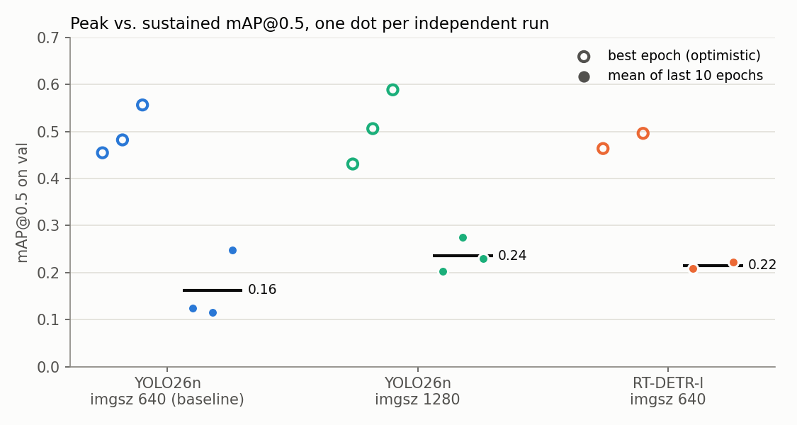
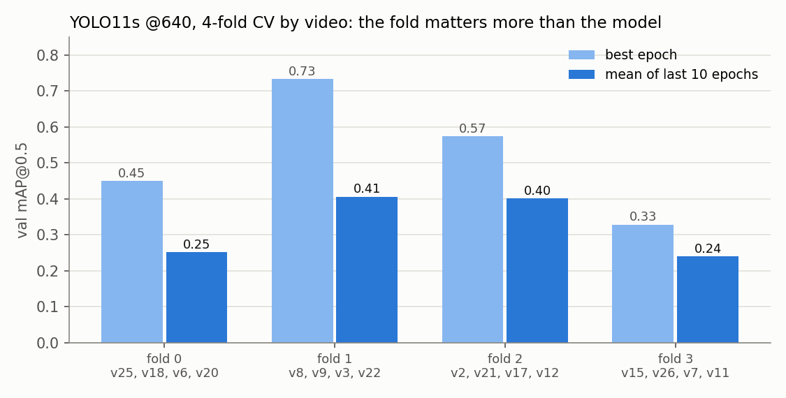

# storozha-anti-ambush

Vision-based detection of grounded "waiter" FPV drones (*ждуни*) from a ground camera,
in hard conditions: night, small objects, motion blur, partial occlusion.

UCU, course "Artificial Intelligence", semester project, 2026. Built from
[`ucu-ai-course/project-template`](https://github.com/ucu-ai-course/project-template).


## Team


## Problem and motivation

Grounded FPV drones fly to a spot, land, and wait for a target with minimal power draw.
They are motionless, often camouflaged, low-contrast, and many are fibre-optic
controlled, so electronic warfare does not see them: visual observation is often the
only channel before the attack. Given a frame from a ground camera, decide whether a
grounded drone is present and return its bounding box.

**Main question:** does targeted expansion of the dataset improve detection on unseen
videos and at night? Secondary: is RGB enough at night, what detection distance is
practical, and does IR help. Full proposal:
[`docs/proposal/`](docs/proposal/).

## Data

Z-FPV-v1: 20 videos, 7196 frames, one class, COCO boxes from CVAT. Gated,
**research-use-only**: nothing derived from the frames is ever committed. Split by
video. Data card, licence terms, split table, checksums: [`data/README.md`](data/README.md).

## Approach

1. **Audit** of Z-FPV-v1 (`results/audit/`): box sizes, day/night, empty frames, colour per
   video. Key finding: median box ~41 px on train but ~8.5 px on val and ~17 px on test.
2. **Baselines** with Ultralytics on Colab GPU: YOLO26n at 640 and 1280, RT-DETR-l at 640.
3. **Cross-validation by video** (4 folds over train+val, test untouched), because with
   20 videos one val split of 4 videos is too noisy to rank models.
4. Next: error analysis per video and day/night with the shared evaluator, then dataset
   expansion (OSINT) and before/after comparison on the same test videos.

## Results

> **Provisional.** Numbers come from Ultralytics' own validation (val split, or val folds),
> not yet from the shared evaluator (`src/zfpv/eval/metrics.py` is still a stub). The test
> videos have not been used. Details and per-run tables:
> [`results/experiments.md`](results/experiments.md), [`results/tables/`](results/tables/),
> [`results/metrics/`](results/metrics/).

`best` is the epoch kept as `best.pt` (picked on the same val set, so optimistic);
`last10` is the mean over the last 10 epochs, which is what the model sustains.

| exp | model, input | indep. runs | best mAP50 | **last10 mAP50** | last10 mAP50-95 | min/epoch |
|---|---|---|---|---|---|---|
| EXP-001 | YOLO26n, 640 | 3 | 0.50 ± 0.04 | **0.16 ± 0.06** | 0.06 ± 0.03 | 1.9 |
| EXP-002 | RT-DETR-l, 640 | 2 | 0.48 ± 0.02 | **0.22 ± 0.01** | 0.09 ± 0.00 | 10.6 |
| EXP-003 | YOLO26n, 1280 | 3 | 0.51 ± 0.06 | **0.24 ± 0.03** | 0.10 ± 0.02 | 2.9 |
| EXP-004 | YOLO11s, 640, 4-fold CV | 4 folds | 0.52 ± 0.15 | **0.33 ± 0.08** | 0.19 ± 0.05 | 0.9 |




What we can say so far:

- **The val metric is very noisy** (±0.2 mAP between neighbouring epochs) and every run
  peaks early (epoch 1–15), then early-stops: the models overfit the train videos.
- **1280 beats 640** on the sustained metric (0.24 vs 0.16) at ~1.5× the time per epoch,
  consistent with the small-object finding of the audit.
- **RT-DETR-l is not better than YOLO26n** and is 5–6× slower to train; not a good fit for
  an on-board GPU either.
- **The choice of held-out videos matters more than the choice of model**: across CV folds
  mAP50 ranges from 0.33 to 0.73. From now on every comparison runs on the same 4 folds.

Planned experiments (EXP-005 … EXP-012) are listed at the end of
[`results/experiments.md`](results/experiments.md): 640 vs 1280 under CV, scale
augmentation, a P2 small-object head, a fair-sized transformer (RF-DETR-S / RT-DETR-R18),
Faster R-CNN as a two-stage reference, SAHI tiling, and finally the shared evaluator on test.

## Quick start

Local (laptop, CPU: data pipeline, audit, evaluation):


Training (Colab GPU): notebook [`notebooks/model-evaluations.ipynb`](notebooks/model-evaluations.ipynb);
setup notes in [`notebooks/README.md`](notebooks/README.md#running-on-colab).

## Repository structure

```
src/zfpv/data/      frames, coco_to_yolo, split, audit, tiling
src/zfpv/eval/      Detector interface (one adapter per model library) + shared evaluator
scripts/            download_data.py, prepare_data.py: thin CLIs over src/
config/             default.yaml + splits/video_split_manifest.csv (the split is config)
notebooks/          NN-topic-initials.ipynb, one owner each (see notebooks/README.md)
results/            experiments.md, metrics/*.json, figures/ (committed, small)
data/               gitignored except data card + checksums
models/             gitignored; weights stay private (see models/README.md)
tests/              leakage guards and conversion tests (no gated data needed)
docs/               proposal, poster, slides, CONTRIBUTING.md
```

## Reproducibility


## AI usage

## Contribution statement

| Member | Contribution | Responsible for |
|---|---|---|
| Andrii Kulbaba | 50% | TODO |
| Oleksandr Lykhanskyi | 50% | TODO |

## License and citation

| | License |
|---|---|
| Code | MIT, see [`LICENSE`](LICENSE) |
| Data | Z-FPV-v1 terms (research-use-only, gated), see [`data/README.md`](data/README.md) |
| Trained models | Not published; inherit the data terms |
| Text / poster / slides | CC BY 4.0 |
