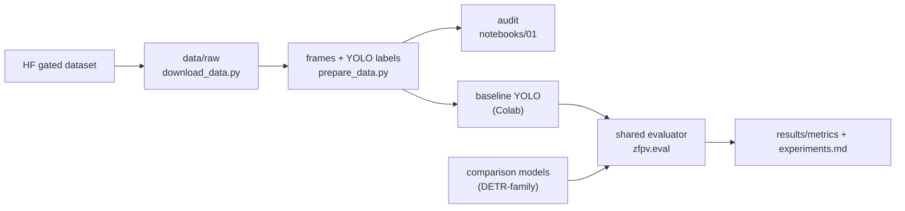

# storozha-anti-ambush

Vision-based detection of grounded "waiter" FPV drones (*ждуни*) from a ground camera,
in hard conditions: night, small objects, motion blur, partial occlusion.

UCU, course "Artificial Intelligence", semester project, 2026. Built from
[`ucu-ai-course/project-template`](https://github.com/ucu-ai-course/project-template).


## Team

| Name | GitHub | Role |
|---|---|---|
| Andrii Kulbaba | [@Luzefik](https://github.com/Luzefik) | TODO |
| Oleksandr Lykhanskyi | TODO | TODO |

## Problem and motivation

Grounded FPV drones fly to a spot, land, and wait for a target with minimal power draw.
They are motionless, often camouflaged, low-contrast, and many are fibre-optic
controlled, so electronic warfare does not see them: visual observation is often the
only channel before the attack. Given a frame from a ground camera, decide whether a
grounded drone is present and return its bounding box.

**Main question:** does targeted expansion of the dataset improve detection on unseen
videos and at night? Secondary: is RGB enough at night, what detection distance is
practical, and does IR help. Full proposal:
[`docs/proposal/`](docs/proposal/).

## Data

Z-FPV-v1: 20 videos, 7196 frames, one class, COCO boxes from CVAT. Gated,
**research-use-only**: nothing derived from the frames is ever committed. Split by
video. Data card, licence terms, split table, checksums: [`data/README.md`](data/README.md).

## Approach



1. Audit Z-FPV-v1 (box sizes, day/night, empty frames, split check).
2. Baseline detector; compare configurations; SAHI for small objects.
3. Error analysis by category (night, distance, occlusion, blur).
4. Dataset expansion (OSINT videos, auxiliary datasets).
5. Retrain and compare with the baseline on the same test videos.

## Results

TODO: none yet. Every number reported here must come from `results/metrics/*.json`
(shared evaluator) and have an entry in [`results/experiments.md`](results/experiments.md).

## Quick start

Local (laptop, CPU: data pipeline, audit, evaluation):

```bash
git clone https://github.com/Luzefik/storozha-anti-ambush.git && cd storozha-anti-ambush
make setup                     # .venv + deps + editable install + pre-commit hooks
source .venv/bin/activate
hf auth login                  # account must have access to the gated dataset
make data                      # download/verify -> frames -> YOLO labels
pytest
```

Training (Colab GPU): see [`notebooks/README.md`](notebooks/README.md#running-on-colab).

## Repository structure

```
src/zfpv/data/      frames, coco_to_yolo, split, audit, tiling
src/zfpv/eval/      Detector interface (one adapter per model library) + shared evaluator
scripts/            download_data.py, prepare_data.py: thin CLIs over src/
config/             default.yaml + splits/video_split_manifest.csv (the split is config)
notebooks/          NN-topic-initials.ipynb, one owner each (see notebooks/README.md)
results/            experiments.md, metrics/*.json, figures/ (committed, small)
data/               gitignored except data card + checksums
models/             gitignored; weights stay private (see models/README.md)
tests/              leakage guards and conversion tests (no gated data needed)
docs/               proposal, poster, slides, CONTRIBUTING.md
```

## Reproducibility

- Seed in `config/default.yaml`, applied with `zfpv.utils.set_seed()`.
- Pinned CPU dependencies in `requirements.txt`; GPU stack in `requirements-train.txt`
  (pinned after the first successful run).
- Each metrics JSON stores `zfpv.utils.env_info()`: Python, platform, device, package
  versions, git commit.
- Data verified by sha256 (`data/raw/CHECKSUMS.txt`).

## Development

```bash
flake8 src/ scripts/ tests/ && black --check src/ scripts/ tests/ && isort --check src/ scripts/ tests/
pytest
```

Branches, PRs, commit conventions: [`docs/CONTRIBUTING.md`](docs/CONTRIBUTING.md).

## AI usage

| Tool | Used for | How the result was checked |
|---|---|---|
| Claude | Initial repository scaffold (structure, configs, data card draft, download script, stub modules with TODOs) | TODO: reviewed by ... |

## Contribution statement

| Member | Contribution | Responsible for |
|---|---|---|
| Andrii Kulbaba | 50% | TODO |
| Oleksandr Lykhanskyi | 50% | TODO |

## License and citation

| | License |
|---|---|
| Code | MIT, see [`LICENSE`](LICENSE) |
| Data | Z-FPV-v1 terms (research-use-only, gated), see [`data/README.md`](data/README.md) |
| Trained models | Not published; inherit the data terms |
| Text / poster / slides | CC BY 4.0 |
